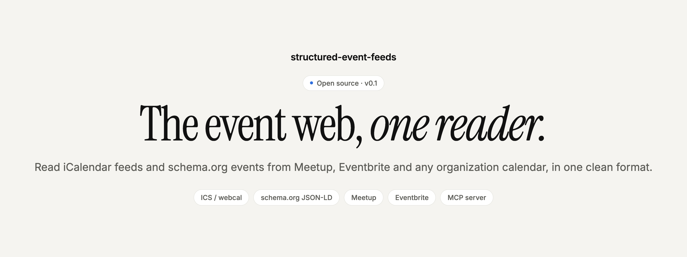
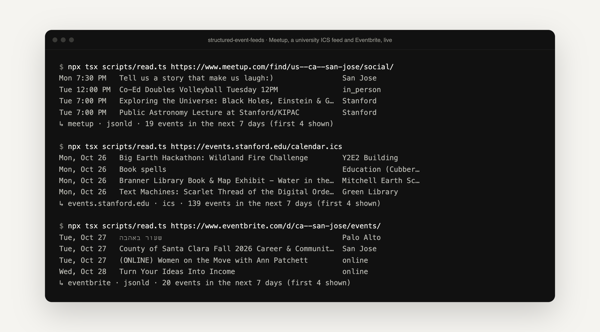

<p align="center">
  <picture>
    <source media="(prefers-color-scheme: dark)" srcset=".github/assets/banner-dark.png">
    
  </picture>
</p>

<p align="center">
  <strong>One reader for the public event web.</strong><br>
  Point it at an ICS feed or a public events page. Get back clean, normalized events, without writing a scraper for each site.
</p>

<p align="center">
  <a href="#quick-start"><strong>Quick start</strong></a> ·
  <a href="#where-it-reads-from"><strong>Sources</strong></a> ·
  <a href="#use-it-from-an-ai-agent-mcp"><strong>MCP server</strong></a> ·
  <a href="https://github.com/mihirkavi/luma-discovery"><strong>Sibling: luma-discovery</strong></a> ·
  <a href="#honest-status"><strong>Status</strong></a>
</p>

<p align="center">
  <a href="LICENSE"></a>
  
  
  <a href="https://github.com/mihirkavi/structured-event-feeds/actions/workflows/ci.yml"></a>
</p>

<p align="center">
  
  <br><sub>Real runs against public pages and feeds on 26 October 2026. The same command reads JSON-LD pages and ICS feeds.</sub>
</p>

## Why structured-event-feeds

Most of the event web already publishes machine-readable data. Universities, libraries, cities, IEEE and ACM chapters and Meetup groups publish **iCalendar (ICS) feeds**. Meetup and Eventbrite embed **schema.org `Event`** data in their public pages so search engines can read them. The hard part is the details: folded lines, time zones, recurring rules, nested JSON-LD and date-only listings.

**structured-event-feeds handles those details once.** Give it a URL; it detects the format, parses it carefully, filters to your time window and returns the same small *open event record* as [luma-discovery](https://github.com/mihirkavi/luma-discovery). It never signs in and never guesses: a page without structured data returns `format: 'none'`, not invented events.

<table>
  <tr>
    <td width="33%" valign="top">
      <h3>🗓️ ICS done properly</h3>
      Time zones (including Windows zone names), all-day dates, and recurring events expanded in the event's own zone, with <code>EXDATE</code> and <code>RECURRENCE-ID</code> overrides.
    </td>
    <td width="33%" valign="top">
      <h3>🧩 schema.org aware</h3>
      Finds <code>Event</code> and its subtypes inside <code>ItemList</code>, <code>ListItem</code> and <code>@graph</code>. Maps venue, geo, organizer, status, attendance mode and prices.
    </td>
    <td width="33%" valign="top">
      <h3>🤝 A polite guest</h3>
      Unauthenticated GET only. Follows robots.txt by default, with a timeout and a 6 MB size cap. No RSVPs, tickets or forms, ever.
    </td>
  </tr>
</table>

## Where it reads from

| Source | How | Helper |
| --- | --- | --- |
| **Meetup** topic and city pages | schema.org JSON-LD on the public `/find/<place>/<topic>/` pages Meetup lists in its sitemap | `sources.meetupFind({ place: 'us--ca--san-jose', topic: 'hiking' })` |
| **Meetup** groups | each group's public ICS feed | `sources.meetupGroupIcs('sfpython')` |
| **Eventbrite** | schema.org JSON-LD on public `/d/<place>/<topic>/` browse pages and event pages | `sources.eventbriteSearch({ place: 'ca--san-jose', topic: 'social' })` |
| **Luma** calendars | each public calendar's ICS feed | `sources.lumaCalendarIcs('cal-…')` |
| **Universities, IEEE/ACM chapters, cities, libraries, venues** | any ICS feed, or any page with schema.org events | `'https://events.stanford.edu/calendar.ics'` |

## Quick start

Requires Node 22.13+ (or a bundler that compiles TypeScript). The package ships TypeScript source.

**Try it on any feed or page** (no account, no key):

```bash
git clone https://github.com/mihirkavi/structured-event-feeds && cd structured-event-feeds
npm install
npx tsx scripts/read.ts https://events.stanford.edu/calendar.ics     # [days], default 7
```

**Use it as a library:**

```bash
npm install github:mihirkavi/structured-event-feeds
```

```ts
import { sources, StructuredFeedClient } from 'structured-event-feeds';

const feeds = new StructuredFeedClient();
const range = { windowStart: new Date(), windowEnd: new Date(Date.now() + 7 * 86_400_000) };

const meetup = await feeds.read(sources.meetupFind({ place: 'us--ca--san-jose', topic: 'social' }), range);
const stanford = await feeds.read('https://events.stanford.edu/calendar.ics', range);

console.log(meetup.format, meetup.events.length); // e.g. "jsonld" 19
```

Already have the content? `parseIcs(text, options)` and `extractJsonLdEvents(html, options)` work on text you fetched yourself.

## Use it from an AI agent (MCP)

```bash
npm run mcp   # stdio transport
```

| Tool | What it does |
| --- | --- |
| `read_event_feed` | Reads events from any ICS/webcal feed or public page with schema.org `Event` data |
| `search_meetup` | Reads Meetup's public find page for a place slug and optional topic |
| `search_eventbrite` | Reads Eventbrite's public browse page for a place slug and topic |

Add it to Claude Code with `claude mcp add structured-event-feeds -- npx tsx /path/to/structured-event-feeds/src/mcp.ts`.

## How it works

```text
URL ─▶ robots.txt check ─▶ GET (timeout, 6 MB cap) ─▶ ICS?  ─▶ unfold, zones, expand recurrences ─┐
                                                      HTML? ─▶ find schema.org Event in JSON-LD  ──┼─▶ filter to window ─▶ open event records
                                                      none? ─▶ format: 'none', no guessing  ───────┘
```

<details>
<summary><strong>Parsing details</strong></summary>
<br>

- **ICS:** line unfolding, escaped text, UTC, floating, `TZID` (including common Windows and Rails zone names) and all-day dates. Expands `DAILY`, `WEEKLY` (with `BYDAY`) and `MONTHLY`-by-day rules with `INTERVAL`, `COUNT`, `UNTIL` and `EXDATE` in the event's own time zone, and applies `RECURRENCE-ID` overrides. Other rules return the first occurrence, marked as recurring.
- **JSON-LD:** finds `Event` and its subtypes (`SocialEvent`, `BusinessEvent`, …) inside `ItemList`, `ListItem` and `@graph`. Maps status, attendance mode, venue and geo, organizer, offers (free or price range, sold out) and image. Date-only listings are flagged `dateOnly: true`.
- **Fetching:** unauthenticated GET only, robots.txt `User-agent: *` rules respected by default, a 12-second default timeout and a 6 MB size cap. Obvious private-network hostnames (`localhost`, `127.*`, `10.*`, `192.168.*`, `169.254.*`, `*.local`) are refused.
- **Meetup and robots.txt:** Meetup's robots.txt disallows the `keywords`, `source` and `dateRange` query parameters, so this package never uses Meetup's search parameters. It reads the sitemap-listed topic pages and filters by date itself.

</details>

## What it does not do

- No sign-in, RSVP, ticket purchase or form submission.
- No RSS or Atom yet. RSS items rarely carry machine-readable event times.
- Eventbrite browse pages list dates only. Read the event page itself for the exact start time.

## Honest status

**v0.1.** Verified live on 26 October 2026 (the runs in the screenshot above): 19 Meetup social events, 139 Stanford calendar events and 20 Eventbrite events for the following week. An earlier check on 13 October 2026 found 16, 147 and 20.

- Site markup can change at any time; sources without structured data return `format: 'none'`.
- Large university feeds can be slow. One smoke run on 26 October timed out on the Stanford feed before a retry succeeded.
- The private-network check is a hostname filter, not a full SSRF defence. Don't expose `read_event_feed` to untrusted users on a server inside a private network without your own egress controls.
- Not published to npm yet; install from GitHub.

<details>
<summary><strong>Development commands and project layout</strong></summary>
<br>

```bash
npm test && npm run typecheck
npm run smoke                              # live: Meetup, Eventbrite, Stanford (counts and titles only)
npx tsx scripts/read.ts <url> [days]       # the demo shown above
```

| Path | What it is |
| --- | --- |
| [`src/index.ts`](src/index.ts) | `StructuredFeedClient`, `sources` helpers and polite fetching |
| [`src/ics.ts`](src/ics.ts) | The iCalendar parser and recurrence expansion |
| [`src/jsonld.ts`](src/jsonld.ts) | schema.org `Event` extraction from JSON-LD |
| [`src/time.ts`](src/time.ts) | Wall-clock time to UTC in any IANA zone |
| [`src/mcp.ts`](src/mcp.ts) | The stdio MCP server |
| [`scripts/`](scripts) | Live smoke check and the `read` demo |

CI runs the typecheck and tests on every push and pull request.

</details>

## Part of Open Media Events

structured-event-feeds is one of the event sources behind [Open Media Events](https://github.com/mihirkavi/open-media/tree/main/docs/events), and it is just as useful on its own.

## License

Released under the [MIT License](LICENSE).

<p align="center">
  <br>
  <sub><strong>structured-event-feeds</strong> · Every calendar, one shape.</sub>
</p>
